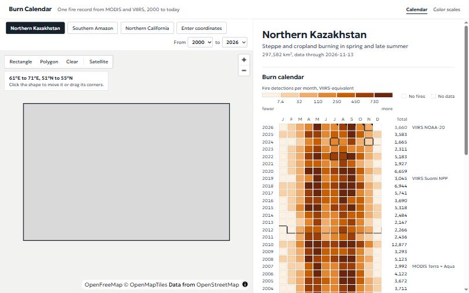

# Burn Calendar: one fire record from MODIS and VIIRS, 2000 to today

Team Catharsis, NASA Space Apps Challenge 2026, challenge **"Harmonization of MODIS and VIIRS Hot Spots"**.

MODIS (since 2000) and VIIRS (since 2012) count fires differently: VIIRS sees about four times more hot spots, so a naive
splice of the two records shows a false jump in 2012. We bring all NASA FIRMS detections to one unit, the
"VIIRS Suomi NPP equivalent", and show the result as a fire calendar (year × month, colored by activity or anomaly) for
any area on the map. It is built for fire services, climate researchers and journalists who need a consistent
26-year series for a region, with honest uncertainty intervals and near-real-time data for 2026.

**Live demo: TBD** (the site is not deployed yet)



## Validation results

Coefficients are fitted on 2012–2020 and tested on 2021–2025 against real Suomi NPP observations
(`data/validation/report.json`, served at `GET /api/v1/method/validation`):

| Region | Bias | Median monthly error | Same with one world coefficient | Pearson r | Months |
| --- | --- | --- | --- | --- | --- |
| Northern Kazakhstan | −8.8 % | 19.9 % | +24.5 % / 30.3 % | 0.990 | 56 |
| Southern Amazon | −0.3 % | 16.3 % | +7.2 % / 38.2 % | 0.999 | 56 |
| Northern California | +4.2 % | 21.4 % | −6.2 % / 21.6 % | 0.999 | 56 |

Bias and the median error are what the coefficients change. Pearson r mostly follows the shared seasonal cycle: raw MODIS,
without any coefficient, scores the same r (0.984 / 0.999 / 0.999) at a bias of about −70 %.

**The 2012 seam is removed.** Worldwide, the ratio of the 2012–2014 mean to the 2009–2011 mean is **3.80** with a naive
splice (raw MODIS before, raw VIIRS after) and **0.97** in the harmonized record.

Worldwide over 5° blocks the MODIS Terra + Aqua forecast reaches r = 0.99 with a weighted error of 12–13 %. Along the way
we found that the Terra and Aqua orbit drift since about 2021 biases any MODIS-to-VIIRS fit that uses recent years, so the
coefficients are fitted on nominal-orbit years only. Days when a satellite did not report are found one by one and filled
from another satellite where one exists (Suomi NPP from NOAA-20, Aqua from Terra); months that could not be filled
completely are flagged. Full method, all metrics and limitations: [docs/methodology.md](docs/methodology.md).

## Architecture

**Pipeline (`pipeline/`, Python + DuckDB).** Downloads the FIRMS yearly archives (MODIS Collection 6.1 since November 2000,
VIIRS 375 m Suomi NPP since 2012, NOAA-20 since 2018) and the 2026 data through the FIRMS Area API, converts them to one
Parquet schema, drops low-confidence and non-vegetation detections, and builds a 0.1° × day grid. It then fits the
harmonization coefficients per 1° cell with shrinkage to a 5° block and the world value, estimates `low`/`high`
intervals, detects days when a satellite did not report and writes the validation report.

**Data (`data/`, not in git).** The pipeline output: the daily and monthly grids, coefficients, uncertainty table,
outage months and gap days, a world summary and the validation report, about 1 GB in total; plus a lightweight copy of all detections
(about 5.7 GB) for the map points and CSV export. [data/README.md](data/README.md) explains how to get or rebuild it.

**Backend (`backend/`, FastAPI + DuckDB).** A read-only API over the Parquet files: calendar for any GeoJSON area,
the current month against the same days of past years, daily values, hot spot points, CSV exports and the validation
report. Every response is checked against the contract in tests.

**Frontend (`frontend/`, React + TypeScript + Vite, MapLibre GL JS).** Draw or pick an area on the map and get the
burn calendar, anomaly view, the "Now" panel, season profile and yearly totals with a trend. The API contract between
the two sides is [contract/openapi.yaml](contract/openapi.yaml), with examples in [contract/examples/](contract/examples/).

## Quick start (local)

You need Python 3.13 (3.11 or newer works; CI uses 3.12), Node 22 or newer (pinned in `frontend/.nvmrc`) and git.
Every command below runs from the repository root, one per line, in Windows PowerShell and in bash alike
(on Linux/macOS use `python3` if `python` is not Python 3).

**1. Python environment.** Create it once, then activate it in every new terminal:

```bash
python -m venv .venv
```

| Shell | Activate |
| --- | --- |
| Windows PowerShell | `.venv\Scripts\Activate.ps1` (if scripts are blocked: `Set-ExecutionPolicy -Scope Process RemoteSigned` first) |
| Git Bash on Windows | `source .venv/Scripts/activate` |
| Linux / macOS | `source .venv/bin/activate` |

```bash
pip install -e "pipeline[dev]" -e "backend[dev]"
```

**2. Data.** Follow [data/README.md](data/README.md): either unpack the team's ready-made archive (about 5 minutes) or
rebuild everything from the FIRMS archives (about 1.5 hours, 20 GB of disk, 12 GB of RAM):

```bash
python pipeline/download_archives.py
```

```bash
python pipeline/to_parquet.py
```

```bash
python pipeline/grid.py
```

`to_parquet.py` without arguments converts every archive in `data/raw/`; it also accepts files or patterns such as
`data/raw/modis_*.zip` and expands them itself, so they work in PowerShell too.

**3. Harmonization and the validation report** (seconds, run after the data is in place):

```bash
python pipeline/harmonize.py
```

```bash
python pipeline/validation.py
```

Optional: `python pipeline/points_serve.py` builds `data/points_serve/` for the map points and the points CSV export
(about 11 minutes), and `python pipeline/fetch_api.py` loads 2026 through the FIRMS Area API (needs a free key, see
`.env.example`). The full step table, including the 2026 refresh, is in [pipeline/README.md](pipeline/README.md).

**4. Backend**

```bash
cp .env.example .env
```

```bash
cd backend
```

```bash
uvicorn app.main:app --port 8000 --env-file ../.env
```

API docs: http://localhost:8000/api/v1/docs. Details: [backend/README.md](backend/README.md).

**5. Frontend** (in a second terminal, from the repository root)

```bash
cd frontend
```

```bash
npm ci
```

```bash
npm run dev:api
```

Open http://localhost:5173. `npm run dev` runs the frontend on the contract examples without the backend.
Details: [frontend/README.md](frontend/README.md).

**Checks (as in CI)**, with the environment active. In `pipeline/` and again in `backend/`:

```bash
ruff check .
```

```bash
ruff format --check .
```

```bash
pytest -q
```

The contract check needs its own tools once (`pip install -r contract/tools/requirements.txt`), then
`python contract/tools/validate.py` from the repository root. Frontend: `npm run lint`, `npm test` and `npm run build`
in `frontend/`.

## Repository layout

```text
├── pipeline/    FIRMS download, common schema, grids, harmonization, validation
├── backend/     FastAPI API
├── frontend/    React app
├── contract/    API contract (openapi.yaml) and response examples
├── docs/
│   ├── methodology.md     method and validation (Russian version: methodology.ru.md)
│   ├── submission/        texts for the Space Apps submission
│   └── demo/              screenshots and demo materials
└── data/        data, not in git (see data/README.md)
```

## Data and acknowledgements

Fire detections: NASA FIRMS, https://www.earthdata.nasa.gov/data/tools/firms. The full list of data, services and tools,
including how AI assistance was used, is in [docs/submission/resources.md](docs/submission/resources.md).

We acknowledge the use of data and/or imagery from NASA's Fire Information for Resource Management System (FIRMS),
part of NASA's Land, Atmosphere Near real-time Capability for Earth observations (LANCE) and NASA's Earth Science Data
and Information System (ESDIS).

## License

[Apache License 2.0](LICENSE).

## Team

Catharsis, NASA Space Apps Challenge 2026:

- [Left2Bad](https://github.com/Left2Bad): data pipeline, harmonization method, backend
- [Miraculum-ADA](https://github.com/Miraculum-ADA): frontend, interface design, API contract
